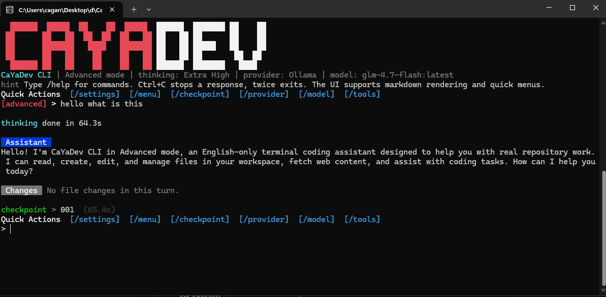

# CaYaDev CLI

CaYaDev CLI is a lightweight open-source AI coding terminal tool built to be simple, flexible, and easy to adapt to smaller models.

The interface is fully English. The product identity follows the CaYaDev visual direction: dark terminal background, sharp red and white accents, and a direct command-line workflow.

## Preview



## Features

- Four runtime modes: `advanced`, `medium`, `normal`, and `low`
- Per-message checkpoints stored locally
- File creation, editing, reading, searching, and deletion
- Delete actions always ask for permission
- Optional `web_fetch` tool for browsing raw web pages
- Optional `ask_question` tool for interactive clarification
- First-run provider setup wizard
- Ollama, OpenAI, Claude / Anthropic, OpenRouter, and custom provider support
- Rich terminal colors and markdown-style assistant rendering
- Thinking spinner with elapsed time
- Configurable thinking level: `low`, `medium`, `high`, `extra_high`
- Per-turn file change summary with added and removed line counts
- Quick action menu and checkpoint restore flow
- Minimal dependency footprint using built-in Node.js modules

## Mode Matrix

| Mode | Intent | ask_question | web_fetch | Prompt Style |
| --- | --- | --- | --- | --- |
| `advanced` | Full capability | Yes | Yes | Full agent prompt |
| `medium` | Good balance | No | Yes | Standard agent prompt |
| `normal` | Stable default | No | No | Standard coding prompt |
| `low` | Better for simpler models | No | No | Extra-constrained low-complexity prompt |

## Requirements

- Node.js 20+
- A supported provider account or a local Ollama instance

## Build And Run

Install:

```powershell
npm install
```

Build:

```powershell
npm run build
```

Build a single Windows `.exe`:

```powershell
npm run build:exe
```

The packaged executable is written to:

```text
dist-exe/CaYaDevCLI.exe
```

Run from source:

```powershell
npm start
```

Run the built copy:

```powershell
node dist/src/index.js --mode advanced
```

Run the packaged `.exe`:

```powershell
.\dist-exe\CaYaDevCLI.exe
```

Notes:

- The `.exe` build uses Node.js Single Executable Applications on Windows.
- The Windows executable icon is generated from `CYEditorLogo2.svg`.
- Build it on the same Windows machine or CI environment where Node.js is installed.
- After blob injection, Windows may report that the original Node signature is no longer valid. Re-sign the final `.exe` if you plan to distribute it publicly.

## Quick Start

1. Start the CLI:

```powershell
npm start
```

2. On the first launch, the CLI asks for:

- Provider
- Base URL
- API key when required
- Model selection or manual model name

3. The selection is stored locally in `.cayadev/config.json`.

You can still override values with CLI flags or environment variables:

```powershell
$env:CAYA_PROVIDER="ollama"
$env:CAYA_BASE_URL="http://localhost:11434"
$env:CAYA_MODEL="qwen2.5-coder:14b"
$env:CAYA_API_KEY=""
```

You can also use the binary name after `npm link`:

```powershell
caya --mode normal
```

Default runtime:

- Mode: `advanced`
- Thinking: `extra_high`

## CLI Commands

- `/help` Show commands
- `/mode` Show current mode
- `/mode <name>` Switch mode at runtime
- `/provider` Open the provider setup wizard
- `/provider current` Show the current provider
- `/model` Open the model selector
- `/model <name>` Switch model at runtime
- `/thinking` Show current thinking level
- `/thinking <level>` Set `low`, `medium`, `high`, or `extra_high`
- `/settings` Open the runtime settings menu
- `/checkpoint` Open the checkpoint restore menu
- `/checkpoint <id>` Restore a specific checkpoint
- `/menu` Open the quick action menu
- `/tools` Show tools available in the current mode
- `/checkpoints` List checkpoints for the current session
- `/session` Show session details
- `/config` Show active runtime config
- `/exit` Exit the app
- `Ctrl+C` Stop the current response
- `Ctrl+C` twice quickly Exit the app

## Checkpoints

Every completed user message creates a checkpoint under `.cayadev/sessions/<session-id>/checkpoints/`.

The current implementation keeps a full workspace snapshot for each completed turn, excluding common heavy folders such as `.git`, `.cayadev`, `node_modules`, `dist`, and `coverage`. This keeps the implementation simple and reliable for an open-source first version, but it is not optimized for very large repositories yet.

## Provider Compatibility

Built-in providers:

- `ollama`
- `openai`
- `anthropic`
- `openrouter`
- `custom`

Protocol support:

- OpenAI-compatible chat completions
- Anthropic Messages API
- Ollama chat API

Model listing:

- Ollama uses `/api/tags`
- OpenAI-compatible providers use `/models` when available
- Anthropic uses `/v1/models`
- If model listing is unavailable, the CLI falls back to manual model entry

## Agent Protocol

The CLI uses a text-based tool protocol so it can work with models that do not support native function calling.

Tool call format:

```xml
<tool_call>{"tool":"read_file","args":{"path":"src/index.js"}}</tool_call>
```

Final answer format:

```xml
<final>Your answer here.</final>
```

The `low` mode uses a simpler system prompt that reinforces this protocol more aggressively for smaller or weaker models.

## Project Structure

```text
src/
  core/
    banner.js
    checkpoints.js
    cli.js
    config.js
    modes.js
    parser.js
    prompts.js
    provider.js
    providers.js
    reasoning.js
    render.js
    tools.js
    utils.js
    workspace.js
  index.js
scripts/
  build.js
test/
  parser.test.js
```

## Notes

- The app is intentionally simple and transparent.
- Delete actions require approval every time.
- The workspace is treated as the current working directory where the CLI starts.
- Provider settings are stored locally in `.cayadev/config.json`, which is ignored by git.
